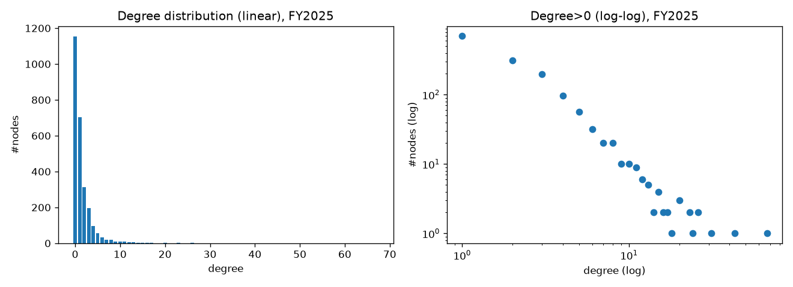
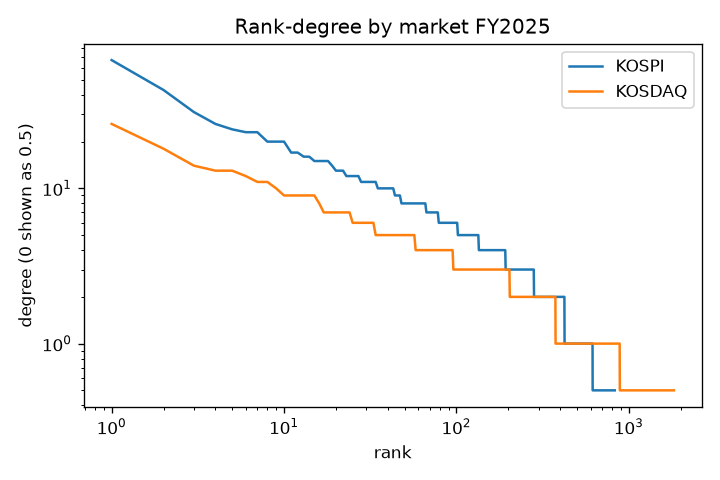

# DEGREE_REPORT: KOSPI+KOSDAQ shareholding network (OpenDART), FY2025 main, FY2024 backup

This report is descriptive only; no model was trained. Every number below comes from `reports/stats_2025.json` / `stats_2024.json` and `data/processed/*.csv`, which were generated in a single run.

## How to reproduce
```bash
export OPENDART_API_KEY=...        # read only from the environment, never written to disk
cd src && P=../.venv/bin/python
$P pipeline.py corpcodes && $P pipeline.py overview && $P pipeline.py listed
$P pipeline.py invest --year 2025 --prev-year 2024
$P pipeline.py resolve
$P build.py --year 2025 --year 2024
$P groups.py --year 2025
$P stats.py --year 2025 --backup 2024
```
Raw responses are cached in `data/raw/` (git-ignored), so a rerun mostly reads from the cache and is resumable.

## Graph definition
- **Nodes**: the 2,655 companies whose current `company.json` corp_cls is Y or K (KOSPI 829, KOSDAQ 1,826). The node set is a snapshot of companies listed **at fetch time (2026-11)**. Companies delisted in 2024–2025 are not in it (survivor bias).
- **Edges**: one row of `otrCprInvstmntSttus` (타법인출자현황, 사업보고서 11011) gives investor → investee, keeping only rows where the investee resolves to a listed node. The directed version is `edges.csv`. The undirected version is `edges_undirected.csv` (`weight_max` = maximum ownership %; `directions` = uv/vu/both).
- **Entity resolution**: R1 exact corp_name → R2 normalized corp_name (unique match) → R3 normalized stock_name (unique match). Normalization strips (주)/㈜/주식회사/(유)/Co.,Ltd/Inc/Corp and whitespace. Anything that fails these rules is recorded with its reason in `unmatched_investees.csv` / `discarded_investees.csv`; nothing is dropped silently.

## Scale and connectivity
| | FY2025 | FY2024 |
|---|---|---|
| Nodes | 2,655 | 2,655 |
| Directed edges | 2,087 | 1,904 |
| Undirected edges | 2,002 | 1,842 |
| Mutually held pairs (both) | 85 | 62 |
| Undirected edges / nodes | 0.754 | 0.694 |
| Connected components | 1,281 | 1,356 |
| Components with >1 node | 127 | 141 |
| LCC nodes (share) | 1,187 (44.7%) | 1,099 (41.4%) |

**Stop-condition check**: FY2025 undirected edges 2,002 ≥ nodes/2 = 1,327.5, so the condition is **not triggered** (FY2024: 1,842 ≥ 1,327.5).

## Degree distribution (undirected)
| | mean | median | p20 | p50 | p80 | p95 | p99 | max | deg=0 | deg=1 | deg=2 |
|---|---|---|---|---|---|---|---|---|---|---|---|
| All 2025 | 1.51 | 1 | 0 | 1 | 2 | 6 | 12.5 | 67 | 43.5% | 26.5% | 11.8% |
| KOSPI 2025 (n=829) | 2.72 | 2 | 0 | 2 | 4 | 10 | 20 | 67 | 25.7% | 23.3% | 17.1% |
| KOSDAQ 2025 (n=1826) | 0.96 | 0 | 0 | 0 | 2 | 4 | 7 | 26 | 51.5% | 27.9% | 9.4% |
| All 2024 | 1.39 | 1 | 0 | 1 | 2 | 5 | 12 | 65 | 45.8% | 25.6% | 12.6% |

**Conclusion**: the distribution is clearly long-tailed (max 67 vs median 1, p99/p50 ≈ 12). **Low-degree nodes are the majority**: 82% have degree ≤2, and 43.5% (1,154 companies) are isolated. KOSDAQ is much sparser than KOSPI. A power-law fit was not done (未验证); the plots only show the shape.



(FY2024: `degree_dist_2024.png`, `degree_rank_by_market_2024.png`)

## Top 20 by degree (FY2025)
group_proxy is an **approximate** group label (see below; 未验证, not the official 공정위 기업집단 designation).

| # | Company | Market | Degree | group_proxy |
|---|---|---|---|---|
|1|삼성전자|KOSPI|67|이재용|
|2|현대해상화재보험|KOSPI|43|정몽윤|
|3|대신증권|KOSPI|31|양홍석|
|4|푸른저축은행|KOSDAQ|26|주신홍|
|5|네이버|KOSPI|26|국민연금공단 (*)|
|6|한국자산신탁|KOSPI|24|(주)엠디엠|
|7|서울보증보험|KOSPI|23|예금보험공사|
|8|현대자동차|KOSPI|23|현대자동차 (**)|
|9|경방|KOSPI|20|김담|
|10|한화생명보험|KOSPI|20|한화에너지㈜|
|11|종근당홀딩스|KOSPI|20|이장한|
|12|아이비김영|KOSDAQ|18|손주은|
|13|KG모빌리티|KOSPI|17|KG에코솔루션|
|14|삼성물산|KOSPI|17|이재용|
|15|대한항공|KOSPI|16|조원태|
|16|SK하이닉스|KOSPI|16|최태원|
|17|기아|KOSPI|15|기아 (**)|
|18|삼성생명보험|KOSPI|15|이재용|
|19|삼성화재해상보험|KOSPI|15|이재용|
|20|현대모비스|KOSPI|15|현대모비스 (**)|

(*) The largest shareholder is the National Pension Service; there is no controlling family. (**) Under circular shareholding the climb stops at the company itself, so Hyundai Motor Group is split into several proxies. That proxy is wrong.
Note: many high-degree nodes are **financial companies** (insurers, securities firms, savings banks, trust companies). Their edges are mostly small portfolio stakes rather than control ties.

## Ownership % of edges (FY2025 directed, 1,770 rows with a %)
<5%: 1,018 (57.5%) · 5–20%: 266 · 20–50%: 350 · ≥50%: 136. Another 317 edges have no % ("-" or empty).
→ **Most edges are not control relationships**. If the downstream task needs control or group ties, filter with a threshold (for example ≥20%). That would cut the edge count sharply, probably below the stop line. 未验证; it has not been computed.

## Intra-group share (approximate)
group_proxy is available for 1,501 companies with degree ≥1 (hyslrSttus status 000: 1,487; 013 (no data): 14). Of the 1,973 FY2025 undirected edges where both ends have a proxy, **584 (29.6%)** share the same proxy (FY2024: 531/1,739 = 30.5%).
Method: in the company's hyslrSttus (최대주주 및 특수관계인), take the holder whose relate contains "본인" (otherwise the largest ownership %). If that name resolves to a listed company, climb up its chain (≤6 levels); the top of the chain is the proxy.
Known biases:
- Spacing in personal names is inconsistent, e.g. "이 재 용".
- Circular shareholding splits a group into several proxies.
- A pension fund or public body can end up as the proxy.
- Same-name individuals get merged.
So 29.6% is an approximation and is **likely an underestimate** (未验证).

## Discarded edges and coverage (FY2025, 32,900 raw rows)
| Category | Rows | Share |
|---|---|---|
| Kept (both ends listed) | 2,098 | 6.4% |
| unmatched (no rule matched, typically 공제조합/투자조합/펀드/개인 etc.) | 12,567 | 38.2% |
| foreign_likely (overseas subsidiaries matched by regex) | 8,508 | 25.9% |
| non_listed_domestic (in corpCode but not listed) | 6,599 | 20.1% |
| summary_or_empty (계/합계/empty rows) | 3,122 | 9.5% |
| Self-loops (removed) | 6 | |

FY2024 has the same structure: 31,644 rows, 1,917 kept (6.1%).
- **"Individual" category**: otrCprInvstmntSttus only reports investments in corporations, so no individual investees appear. This category is 0 by construction and has no separate column. 未验证: some 조합 or 개인사업체 may be mixed into unmatched.
- Only 29.7% of listed companies have at least one listed→listed out-edge.
- The kept count (2,098) is higher than the directed edge count (2,087) because duplicate (src, tgt) pairs are merged and their maximum % kept.

## Data-quality list
1. **Low coverage**: only 6.4% of raw rows end up in the graph. The listed-only graph is a strict subgraph of the real ownership network, so the paths that run through unlisted holding companies or SPCs are cut.
2. **Entity-resolution misses**: for example "KT" (corp_name 주식회사 케이티) appears 6 times in unmatched. Abbreviations, English names, and line breaks inside names ("소프트웨어\n공제조합") cause misses. The unmatched list is kept in `data/processed/unmatched_investees.csv` for review. The miss rate was not hand-sampled (未验证).
3. foreign_likely is a regex heuristic, so domestic and foreign can be misclassified (未验证).
4. 317 edges (15%) have no ownership %.
5. Survivor bias: the nodes are listed as of 2026-11.
6. Fiscal years: for companies with non-December year-ends, bsns_year=2025 refers to the fiscal year that closes in 2025 (for example stlm_dt 2025-06-30).
7. Financial companies' portfolio stakes push up degree. These are ownership edges, not control edges.
8. The group proxy is not the official group list (see above).
9. In the raw-response cache, numbers are strings with commas and "-" means empty. The parser handles both.
